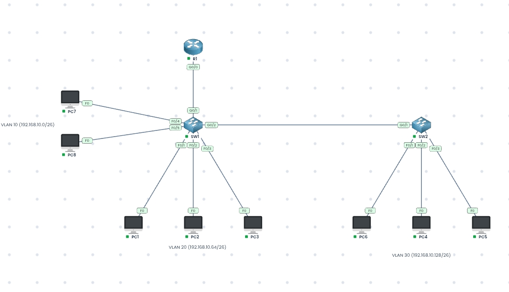

# Inter-VLAN Routing with Router-on-a-Stick


A practical mini lab focused on **Inter-VLAN Routing using Router-on-a-Stick**, combining VLAN configuration, IPv4 subnetting, 802.1Q trunking, and inter-VLAN communication.

---

## 1. Overview

This was a mini lab that combined everything I had learned so far, with a strong focus on **Inter-VLAN Routing using Router-on-a-Stick**.

I had **8 PCs** in one faculty building:
- 2 × Cyber Security department
- 3 × Software Engineering department
- 3 × Data Science department

I wanted each department to have its own independent network for better management and security.  
Although they were all physically in the same building, at Layer 2 they were still in the same broadcast domain. To logically separate them, I created **3 VLANs**.

The original network given was `192.168.10.0/24`.  
I subnetted it using `/26` (which gives 4 usable subnets — more than I needed).  
`/25` would have given only 2 subnets, which was not enough.

Using the **PingMyNetwork Sandbox**, I built and tested everything directly in the browser.

---

## 2. Lab Objectives

- Create three departmental VLANs and subnet the `192.168.10.0/24` network using `/26` prefixes
- Assign switch access ports to the correct VLANs
- Configure 802.1Q trunks (including allowed VLANs)
- Implement Router-on-a-Stick with subinterfaces
- Enable inter-VLAN communication
- Verify end-to-end connectivity with ping
- Document troubleshooting lessons

---

## 3. Network Topology

| Department              | Number of PCs | VLAN ID | Network Address     |
|:------------------------|:-------------:|:-------:|:--------------------|
| Cyber Security          | 2             | 10      | `192.168.10.0/26`   |
| Software Engineering    | 3             | 20      | `192.168.10.64/26`  |
| Data Science            | 3             | 30      | `192.168.10.128/26` |
| **Total**               | **8**         | **3**   | —                   |

### Logical Topology



---

## 4. IP Addressing Plan

Original network: `192.168.10.0/24`  
Subnet mask used: `/26` (`255.255.255.192`) → 64 addresses per subnet (62 usable)

| Department              | VLAN | Network Address       | Default Gateway     | Broadcast Address   |
|:------------------------|:----:|:----------------------|:--------------------|:--------------------|
| Cyber Security          | 10   | `192.168.10.0/26`     | `192.168.10.62`     | `192.168.10.63`     |
| Software Engineering    | 20   | `192.168.10.64/26`    | `192.168.10.126`    | `192.168.10.127`    |
| Data Science            | 30   | `192.168.10.128/26`   | `192.168.10.190`    | `192.168.10.191`    |

I assigned the **last usable IP** in each subnet as the gateway on the router subinterfaces.

---

## 5. Implementation

### 5.1 VLAN & Access Port Configuration

I entered privileged EXEC mode, then global configuration mode on the switch.

**Software Engineering – VLAN 20** (FastEthernet 0/1 – 0/3):

```cisco
SW1(config)# interface range f0/1-3
SW1(config-if-range)# switchport mode access
SW1(config-if-range)# switchport access vlan 20
```

The VLAN was created automatically when the ports were assigned.

**Cyber Security – VLAN 10** (FastEthernet 0/4 – 0/5):

```cisco
SW1(config)# interface range f0/4-5
SW1(config-if-range)# switchport mode access
SW1(config-if-range)# switchport access vlan 10
```

**Data Science – VLAN 30** was also created and assigned to its respective ports.

### 5.2 Trunk Configuration

I configured the links between the switches and from the switch to the router as 802.1Q trunks and allowed the necessary VLANs:

```cisco
SW1(config)# interface g0/1
SW1(config-if)# switchport mode trunk
SW1(config-if)# switchport trunk allowed vlan 10,20,30

SW1(config)# interface g0/2
SW1(config-if)# switchport mode trunk
SW1(config-if)# switchport trunk allowed vlan 10,20,30
```

### 5.3 Router-on-a-Stick Configuration

On the router I created three subinterfaces, enabled 802.1Q encapsulation (not ISL), and assigned the gateway IPs:

```cisco
R1(config)# interface g0/0.10
R1(config-subif)# encapsulation dot1Q 10
R1(config-subif)# ip address 192.168.10.62 255.255.255.192

R1(config)# interface g0/0.20
R1(config-subif)# encapsulation dot1Q 20
R1(config-subif)# ip address 192.168.10.126 255.255.255.192

R1(config)# interface g0/0.30
R1(config-subif)# encapsulation dot1Q 30
R1(config-subif)# ip address 192.168.10.190 255.255.255.192

R1(config)# interface g0/0
R1(config-if)# no shutdown
```

---

## 6. How Inter-VLAN Routing Works

1. A PC in one VLAN realizes the destination is in a different subnet.
2. It sends the packet to its default gateway (the router subinterface).
3. The switch tags the frame with the correct VLAN ID and sends it over the trunk.
4. The router receives it on the matching subinterface, routes it, and sends it out the correct subinterface with the new VLAN tag.
5. The switch delivers it to the destination access port.

Switches alone cannot perform inter-VLAN routing — the traffic must go to the router first (Router-on-a-Stick).

---

## 7. Verification and Results

After completing the configuration, I pinged devices across all three VLANs.

**Result:** All inter-VLAN pings were successful.

### Verification Checklist

- [x] Created VLANs 10, 20, and 30
- [x] Assigned access ports correctly
- [x] Configured trunks and allowed VLANs
- [x] Created router subinterfaces with 802.1Q encapsulation
- [x] Assigned correct gateway IPs
- [x] Brought router interface up with `no shutdown`
- [x] Successfully pinged between all departments

**View the live project:**  
[Open this lab on PingMyNetwork Sandbox](https://pingmynetwork.com/sandbox)

---

## 8. Troubleshooting Moments & Lessons Learned

During the lab I encountered several real issues that taught me valuable lessons:

1. **Forgot to save the configuration**  
   I kept using `show` commands and noticed the configs had disappeared because I forgot to write them to memory (`copy running-config startup-config` or `write`).

2. **VLAN 30 missing on SW1**  
   On the link between SW1 and SW2, VLAN 30 was in the allowed list but not actually created on SW1.  
   `show vlan brief` revealed it was missing. After creating VLAN 30 on SW1, the pings started working.

3. **Router interfaces are administratively down by default**  
   I had to remember to issue `no shutdown` on the physical interface.

4. **Switches cannot route between VLANs**  
   Inter-VLAN traffic must go to the router first. This is the core reason we use Router-on-a-Stick.

These troubleshooting experiences helped me understand the configuration much more deeply than just following a lab guide.

---

## 9. Key Takeaways

- VLANs logically separate devices that are physically in the same location
- `/26` gives enough subnets when you need three networks from a `/24`
- 802.1Q is the standard trunking protocol (ISL is outdated)
- Router-on-a-Stick is an efficient way to route between multiple VLANs using a single physical interface
- Always save your configuration and verify with `show` commands
- Create the VLAN on every switch that needs to carry it

---
